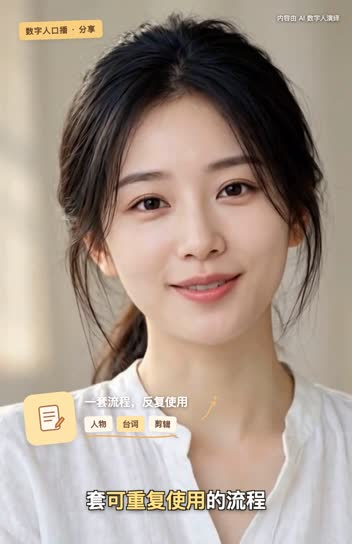

# AI Avatar Video Maker

[English](README.en.md) · 中文

用自己的角色图与口播稿，在 Muse 中逐段生成视频；在本机选剪点、提取真实尾帧、检查台词并制作字幕、可选贴纸和可编辑视频工程。这个项目基于 [andyhuo520/digital-human-koubo](https://github.com/andyhuo520/digital-human-koubo) 的 MIT 代码改造。

**来源声明：** 本项目复用了原作者的字幕时间轴、部分本地处理脚本和 Remotion 包装组件源码；Muse 尾帧接力、配音替换及社区基础工程经过新增或改造。具体清单见 [来源与改造](ATTRIBUTION.md)。

**生成需要自行使用 Muse。** 本项目不提供或调用 Muse API/MCP，不代付、不自动提交生成请求；模型、单次时长、费用和额度以你的 Muse 界面显示为准。可以手动操作，也可以请有电脑操作能力的 Agent 协助。`build_tasks.py` 仅生成本地请求，不会生成视频或扣费。

## 样稿

点击封面或链接观看 / 下载完整 MP4。这两条成片由维护者提供并授权展示，包含人工剪辑与后期配音；[制作说明与配乐署名](docs/demos/README.md)。

| 白衬衫口播 · 30 秒 | 小雅优雅版 · 27 秒 |
|:---:|:---:|
| [](https://github.com/JavieHan/ai-avatar-video-maker/releases/download/samples-v1/talking-head-stickers.mp4) | [](https://github.com/JavieHan/ai-avatar-video-maker/releases/download/samples-v1/xiaoya-elegant.mp4) |
| [▶ 观看 / 下载](https://github.com/JavieHan/ai-avatar-video-maker/releases/download/samples-v1/talking-head-stickers.mp4) · 字幕、暖黄贴纸、6 号配音 | [▶ 观看 / 下载](https://github.com/JavieHan/ai-avatar-video-maker/releases/download/samples-v1/xiaoya-elegant.mp4) · 口播、舞蹈、10 号配音、古琴古筝 |

## 这套流程能做什么

1. 用已授权角色图和稿子离线准备每段请求。以单段 10 秒为默认规划，先确认你当前 Muse 的实际限制。
2. 在 Muse 生成一段；听台词并查看最后一秒，选择表情、声音都合适的剪点。`handoff.py` 导出保留片段和它的实际末帧，再把末帧绑定为下一段的**图片参考**。逐段重复。
3. 导入下载的真实视频；用 `whisper-cli` 辅助检查台词并生成字幕时间轴。实际听审和人物、口型检查仍需人工完成。
4. 可选使用自己生成的音频，按人工确认的发声时点放入视频；制作 Remotion 字幕、可选贴纸及音乐，输出 MP4 和可编辑源码。

**边界：** 图片参考不是硬首帧锁定，不保证人物不漂移或接点必然无痕。后期换声音不改变嘴型，不是音频驱动口型。Whisper 的时间戳是识别和插值结果，不等于逐字口型验收。成片需要实际观看、听审，尤其检查每个接点和闪帧。

## 安装和准备

在 macOS / Linux 的终端中运行；其他系统需要可用的 Python、FFmpeg、whisper.cpp 和 Node 环境。使用自己的 Muse 账号及有权使用的角色、声音和音乐。制作所需的原始人物图片、配音和片段由使用者准备；首页样稿另行授权展示，完整成片单独放在 Releases。

- Python 3、FFmpeg/FFprobe：准备请求、剪接、导入和换声。
- [whisper.cpp](https://github.com/ggml-org/whisper.cpp) 的 `whisper-cli` 和一个本地模型：台词检查与时间轴；模型路径通过 `WHISPER_MODEL` 或 `--model` 指定。
- Node.js 18+、npm：创建 Remotion 工程后安装其依赖并渲染；Remotion 使用条件见 [THIRD_PARTY.md](THIRD_PARTY.md)。
- 本机或其他渠道的 TTS 是**可选外部工具**。本项目不打包 TTS2，也不要求使用特定音色。

```bash
git clone https://github.com/JavieHan/ai-avatar-video-maker.git
cd ai-avatar-video-maker
AVATAR_SKILL="$PWD/skills/ai-avatar-video-maker"
mkdir -p work/demo/downloads work/demo/kept
cp examples/persona.json examples/script.json work/demo/
cd work/demo
```

把有权使用的人物图片放在本目录，命名为 `portrait.png`，或修改 `persona.json` 的 `reference_image`。编辑 `script.json` 为真实台词，编辑人物、画幅及 `voice.description`。示例内容只是格式，不是用户资料。项目输出默认放在 Git 忽略的 `work/` 下。

## 1. 准备请求并生成第一段

```bash
python3 "$AVATAR_SKILL/scripts/build_tasks.py" script.json tasks-s1.json --persona persona.json
```

打开 `tasks-s1.json`，把 `s1` 的 `prompt` 和 `reference_image` **实际作为图片附件**交给 Muse；文件路径文字本身不会上传图片。下载视频到 `downloads/s1.mp4`。每次提交前核对 Muse 的实际时长、额度和请求次数；首段审看通过后再继续。

## 2. 逐段剪辑和尾帧接力

先看第一段结尾，选择一句说完、表情和机位适合衔接的位置；例如决定保留 6 秒：

```bash
python3 "$AVATAR_SKILL/scripts/handoff.py" \
  --video downloads/s1.mp4 --keep-seconds 6 \
  --trimmed kept/s1.mp4 --tail kept/s1-tail.png \
  --tasks tasks-s1.json --next-id s2 --output-tasks tasks-s2.json
```

该命令仅在本机处理，所有输出必须是新文件。它导出 30 fps 保留片段、从该片段实际提取最后一帧，并在新清单中将 `s2` 绑定到这张图，同时打印保留帧数（例中为 180 帧）。请**实际附上 `kept/s1-tail.png`**，把 `tasks-s2.json` 中 `s2` 的提示词发送给 Muse；下载并审看第二段。

更多段时，用上一轮的新任务清单、实际上一段视频和新的输出文件名继续接力。不要把源视频路径或截图文字当作已上传。重做某段后，必须重新检查它的尾帧及后续片段。首帧只是参考，视频生成结果可能改变表情、构图或人物。

## 3. 导入、审核与拼接

以两段为例，先手工创建 `results.json`，其中 `s1` 使用上一步的保留片，`s2` 使用实际下载片段；路径相对 `results.json`：

```json
{
  "s1": {"src": "kept/s1.mp4"},
  "s2": {"src": "downloads/s2.mp4"}
}
```

```bash
python3 "$AVATAR_SKILL/scripts/import_muse.py" tasks-s2.json results.json clips.json
```

导入只验证文件及音轨、记录哈希；它**不会**替你判断台词、人物或口型。逐段看听后，在 `clips.json` 中将符合要求的 `review_status` 改成 `approved`；有问题则保持 `pending` 或设为 `rejected`。改变已绑定图片的内容会使旧请求失效。

```bash
export WHISPER_MODEL="<本机 Whisper 模型的完整路径>"
python3 "$AVATAR_SKILL/scripts/assemble.py" script.json clips.json \
  --tasks tasks-s2.json --out main.mp4 --cut-dir cut \
  --keep-frames s1=180
python3 "$AVATAR_SKILL/scripts/align.py" script.json --cut-dir cut --out tl.json
```

将 `s1=180` 改成接力工具实际打印的帧数；多段时为每个已用作参考的保留段分别加 `--keep-frames 段号=帧数`。此步骤可能重新编码，因此仍需比较成片接点。未指定帧数的段按 Whisper 估计的语音结束点裁尾，**不适用于已用于续接但未登记剪点的段**。

识别与原稿相似度低时会暂停。实际听审后，如果仅是识别误差，使用 `--accept-asr-mismatch s2 --review-note "实际复核依据"`；如果原声确实有错且准备后期换声，用 `--accept-spoken-error s2 --review-note "实际复核依据"`。两者都不会标记口型通过。重跑请换用全新 `--out` 和 `--cut-dir`，不会覆盖已有成片或缓存。

## 4. 可选：替换配音

可以用 TTS2、其他 TTS 或自己录制的声音，**先把配音分成短句并人工确定各句的发声时间**。例如复制 `examples/voice-plan.json`，将每项的 `audio` 改成该文件旁的音频，`at` 改为视频中实际发声秒数；`rate` 是可选语速倍率（0.5–2）。示例时间仅为格式演示。

```bash
python3 "$AVATAR_SKILL/scripts/timed_voice.py" main.mp4 voice-plan.json --out main-redub.mp4
```

这一步保留视频画面、替换原音，不会自动识别或保证准确的口型同步，也不会自动保留原视频的背景声。时间重叠、超出片长或输出已存在时会停止。请听审，并根据实际新配音复核 `tl.json` 的时间；原音生成的字幕时间不一定适用于新声音。

## 5. 创建可编辑工程并渲染

```bash
python3 "$AVATAR_SKILL/scripts/prepare_edit.py" \
  --video main.mp4 --timeline tl.json --output community-edit
cd community-edit
npm install --no-audit --no-fund
bash scripts/render.sh ../finished.mp4
```

使用 `main-redub.mp4` 可制作换声版；也可以在准备工程时加 `--voice 已对齐音轨.wav`、`--music 已授权音乐.mp3` 或 `--stickers 贴纸.json`。贴纸数组格式见 `examples/stickers.json`，秒数按实际视频填写。默认没有额外配音、音乐、贴纸、广告文案或白闪，画布取源视频尺寸并保持完整画面。`render.sh` 默认单线程，已有输出不会覆盖；渲染后仍需核查整条视频，而不是仅看静帧。若遇到渲染异常，可先用 `npx remotion studio` 检查。

## 可复用的 Agent Skill

入口为 [`skills/ai-avatar-video-maker/SKILL.md`](skills/ai-avatar-video-maker/SKILL.md)。让能读取本地文件和使用电脑的 Agent 按此工作，或直接运行上面的命令。它不会自动安装为全局技能，也不保证各 Agent 都能操作 Muse 的界面。

## 许可与来源

本项目基于 [digital-human-koubo](https://github.com/andyhuo520/digital-human-koubo)，保留上游 [MIT LICENSE](LICENSE)、[NOTICE.md](NOTICE.md) 和 [THIRD_PARTY.md](THIRD_PARTY.md)。本发行版刻意不包含上游作者的示例主播、展示图片和视频，除首页明确授权展示的样稿外，不包含使用者的制作素材。代码许可不自动授予第三方服务、模型、音乐或人物形象的使用权；Remotion 等依赖有独立使用条款。
