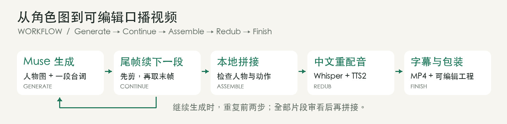
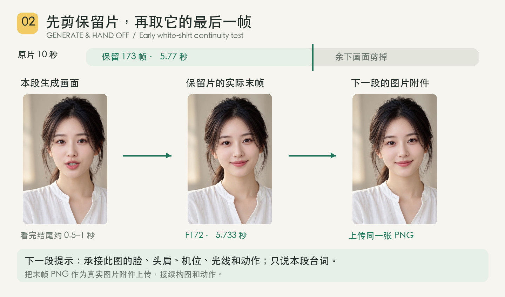
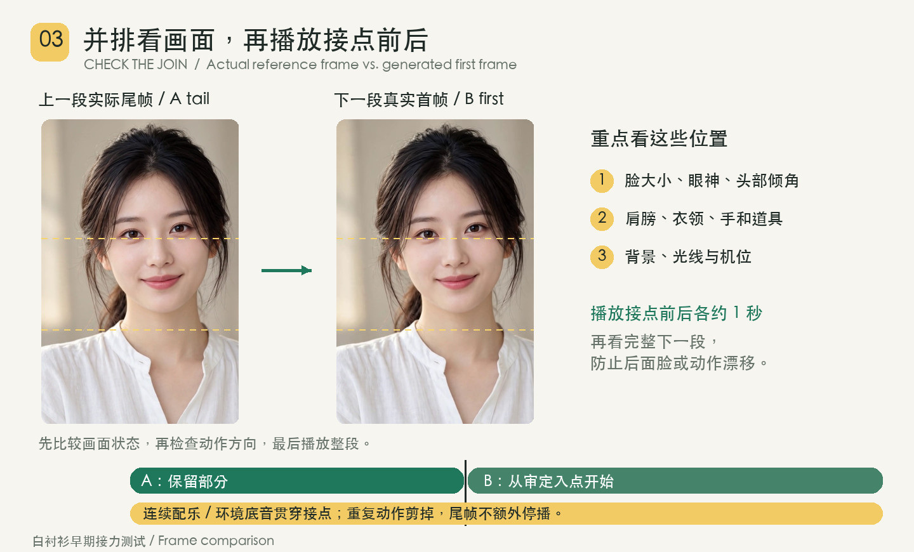
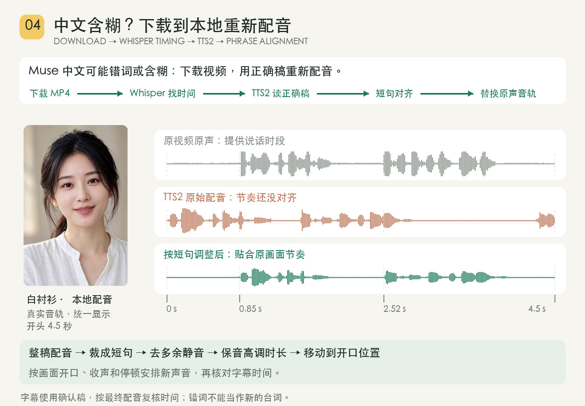
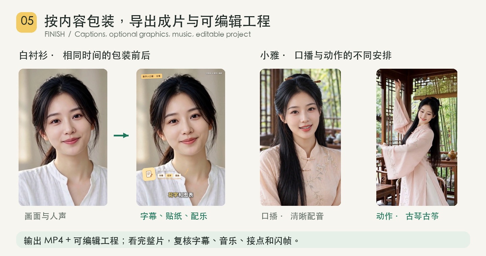

# AI Avatar Video Maker

**一套半手工的 AI 口播制作流程与本地辅助脚本。** 适合想用 Muse 做连续人物视频、愿意逐段审看和调整配音的创作者。你或能操作电脑的 Agent 负责提交生成、审片和确认配音时间，脚本负责取尾帧、剪接、换声和输出可编辑工程。

[English](README.en.md) · [Codex / Claude 配置](docs/agent-setup.md) · [工具与安装](docs/tools.md) · [完整命令](docs/usage.md)

| 需要的外部工具 | 是什么、去哪里用 |
|---|---|
| **Muse** | Meta 的 AI 助手，本流程使用它生成短视频。[官网](https://ai.meta.com/muse/) · [下载](https://ai.meta.com/muse/download/)；开始前确认账号可用图片生成视频。 |
| **TTS2 / Breeze TTS 2** | 按文字生成或克隆配音的语音模型。[官方项目](https://github.com/breezeblue-ai/breeze-tts) · [Mac 社区 MLX 版](https://huggingface.co/mlx-community/Breeze-TTS-2-mlx)。本地模型及输出限研究和非商业用途，见[模型许可](https://huggingface.co/BreezeBlue/Breeze-TTS-2/blob/main/LICENSE)。 |

## 看看能做出什么

点击封面观看或下载完整 MP4。

| 日常口播 · 30 秒 | 古风口播与动作 · 27 秒 |
|:---:|:---:|
| [](https://github.com/JavieHan/ai-avatar-video-maker/releases/download/samples-v1/talking-head-stickers.mp4) | [](https://github.com/JavieHan/ai-avatar-video-maker/releases/download/samples-v1/xiaoya-elegant.mp4) |
| 本地女声配音 · 字幕 · 暖黄贴纸 | 女声配音 · 起身与展袖 · 古琴古筝 |

## 整套流程



## 用 Codex / Claude Code 配置

克隆仓库后，一条命令接入项目技能并检查依赖：

```bash
git clone https://github.com/JavieHan/ai-avatar-video-maker.git
cd ai-avatar-video-maker
bash setup.sh both
```

用 Codex 或 Claude Code 打开这个目录，分别输入 **`$ai-avatar-video-maker`** 或 **`/ai-avatar-video-maker`** 开始。[配置说明与可直接粘贴的提示 →](docs/agent-setup.md)

单独检查环境：`sh skills/ai-avatar-video-maker/scripts/doctor.sh`。配置脚本会列出缺少的依赖；Muse 账号、语音模型及媒体素材由你准备。

## 1. 准备人物和稿子

固定人物、衣服和场景，把台词拆成自然说完的短句。带动作的内容先安排好口播、起身和转身的顺序。


## 2. 逐段生成，用尾帧续下一段

先生成一段并审看，再选保留剪点。**先剪视频，再从保留片提取最后一帧**；把这张图作为图片附件交给 Muse，下一段继续同一人物、姿态、机位和光线。



## 3. 检查接点，再拼接

并排比对上一段末帧和下一段首帧，再播放接点前后各约 1 秒。接得上时直接切接，剪掉重复动作；上一段保留到取尾帧时的同一剪点。配乐或环境底音沿整条时间线连续编排。



## 4. 下载到本地，修正中文配音

Muse 的中文口播可能错词、含糊或节奏不自然。两条样稿都保留画面，下载后用本地配音替换：

1. **Whisper 找时间**：识别原声的大致短语位置，再按波形和画面确认发声起止。
2. **TTS2 读正确稿**：生成选定音色的配音，文字以你的最终稿为准。
3. **按口型节奏剪辑**：切短句、去多余静音、保音高调整时长，再移动到画面开口处，保留停顿。
4. **替换原声、重校字幕**：按最终声音核对字幕，最后单独加入背景音乐。



[配音对齐的具体做法与命令 →](docs/redubbing.md)

## 5. 包装与导出

日常口播可以加字幕和贴纸；动作视频要留出手臂与衣袖的空间。看完整片，核对字幕、声音、接点和闪帧，输出 **MP4 + 可编辑 Remotion 工程**。



图解使用成片截图与早期接力测试，来源和配乐见[样稿说明](docs/demos/README.md)。参考图用于引导下一段；本地重配调整声音节奏，现有嘴部画面保留。

## 来源与许可

基于 [andyhuo520/digital-human-koubo](https://github.com/andyhuo520/digital-human-koubo)，复用并改造了字幕时间轴、部分本地脚本和 Remotion 组件。详见[来源与改造](ATTRIBUTION.md)。代码保留上游 [MIT LICENSE](LICENSE)；外部模型、服务和素材各自适用其许可，见[第三方说明](THIRD_PARTY.md)。
